# Tiqora — a RISC-V microcontroller the size of a grain of salt

**RV32E + 11 Xpulse timing instructions · Tiny Tapeout 3 × 2 tiles · SkyWater sky130 · Apache 2.0 · maintained by [@Normansrule](https://github.com/Normansrule)**

### [▶ Open the project website: normansrule.github.io/tiqora-skywater130](https://normansrule.github.io/tiqora-skywater130/)

Everything in this repository, explained and explorable in your browser: watch the chip run, fire a deadline of your own, open the chip atlas and check the evidence behind every number. No install, works on a phone.

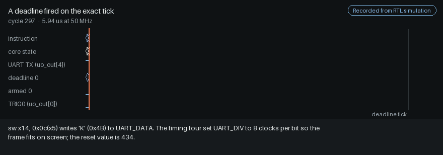

<sub>Recorded, not drawn: one window of `make -C test tour`, a simulation of the submitted top module
with flash and RAM models on its pins, rendered by `docs/tools/readme_media.py`.
[Still image](docs/images/explorer/tour.png) for readers with motion turned off.</sub>

> **Tiqora was called TinyPulse until October 2026.** Old links redirect; the C API, opcodes,
> register map and bootloader protocol are unchanged, and `#include "tinypulse.h"` still works.

**A complete 32-bit microcontroller for six Tiny Tapeout tiles (a 3 × 2 block, 0.115 mm² of die, 420 €).**
It runs RISC-V code from a 16 MB flash chip, or straight from a USB (Universal Serial Bus)
serial link with no programmer, has 16 MB of RAM (random-access memory), 8 inputs, 8 outputs,
a UART (universal asynchronous receiver-transmitter, a serial port) for `printf`, and something no
ordinary microcontroller has: **instructions that treat time as an operand.** It timestamps pin
edges in hardware and fires output pulses on the exact clock tick it was told to (cycle-exact
relative to the supplied clock; oscillator error and pad delay are separate matters).

**It exists as tested RTL (register-transfer level: the hardware description a chip is built
from), and as a layout, not yet as a chip.** At 3 × 2 tiles the Tiny Tapeout GDS, pre-flight and
gate-level workflows pass on `main` (GitHub run 40431523830, commit 3684851). Nothing has run on silicon or on a real FPGA (field-programmable
gate array) board.

It's for people who need a pin to move on an exact clock tick (lab triggers, test benches,
pulse trains, timestamping) and would rather write that in C than in Verilog, and for anyone
curious how small a whole computer can get.

**Key features**

- **Time as an operand.** Eleven Xpulse instructions read the timebase, arm a deadline, wait
  for it and pop timestamped pin edges. The trigger pin fires on the programmed tick with no
  software in the path.
- **Nibble-serial RV32E.** One 4-bit adder does every 32-bit add in eight clocks while the
  register file rotates past it. That is what makes it small.
- **Runs real C**, compiled with Clang, from QSPI (quad serial peripheral interface) flash or
  loaded over USB serial with no flasher.
- **Evidence on every number.** Each result in this README says whether it was measured (and
  with which command and version), estimated, failed or not done yet.
- **An explorer you can open offline**: recorded tours of the running chip, a lab where you fire
  your own deadline, and a zoom from a grain of salt down to one flip-flop.

### Explore it

| | |
|---|---|
| [**Overview**](https://normansrule.github.io/tiqora-skywater130/index.html) | fire a deadline of your own; scroll from a grain of salt down to one flip-flop; what goes in, what happens inside, what comes out, what is proven |
| [**Tours**](https://normansrule.github.io/tiqora-skywater130/tours.html) | six sequences recorded from the RTL, with play, step, scrub and captions; change the operands of an add and watch the register ring turn nibble by nibble |
| [**Chip atlas**](https://normansrule.github.io/tiqora-skywater130/atlas.html) | every block from the elaborated RTL: ports, legal values, behaviour, tests, connections you can follow |
| [**Physical design**](https://normansrule.github.io/tiqora-skywater130/physical.html) | measured cell area per block against the 3 × 2 die, what the layout run showed, and the routed layout to zoom into, down to every wire, with a clock edge you can send |
| [**Evidence**](https://normansrule.github.io/tiqora-skywater130/evidence.html) | the ladder from RTL tests to silicon, with the command behind every rung |

Each page is one self-contained file: open `docs/site/index.html` from a clone and it works offline.
The links above are the GitHub Pages copy, published by `.github/workflows/pages.yaml` on every push to
`main`; should it ever be down, the same pages open [through htmlpreview](https://htmlpreview.github.io/?https://github.com/Normansrule/tiqora-skywater130/blob/main/docs/site/index.html).

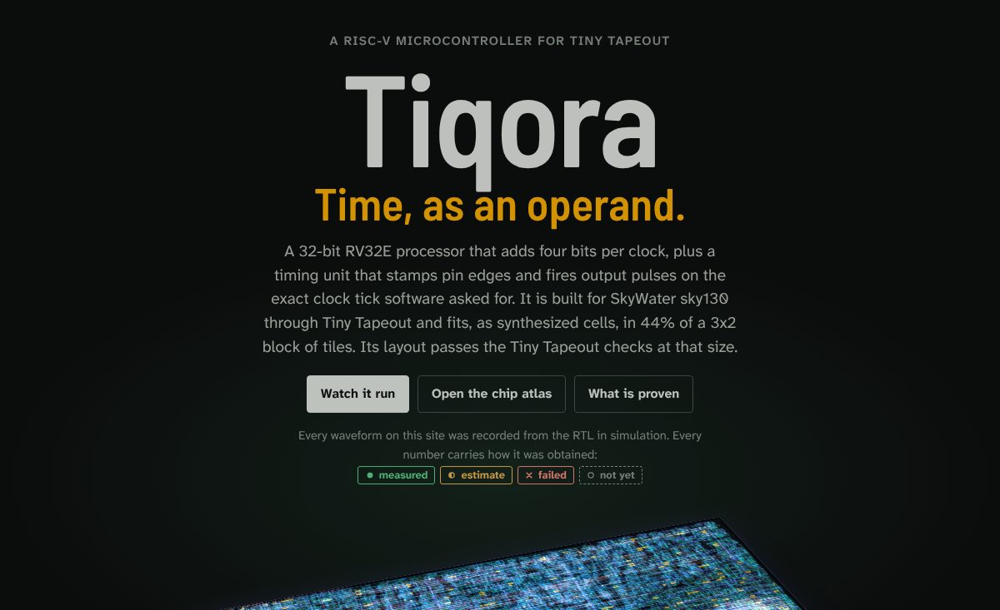

| Fire a deadline | The zoom's last view |
|---|---|
| 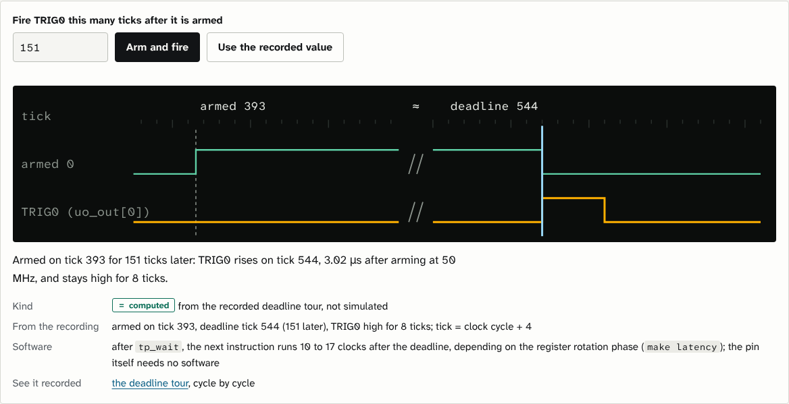 | 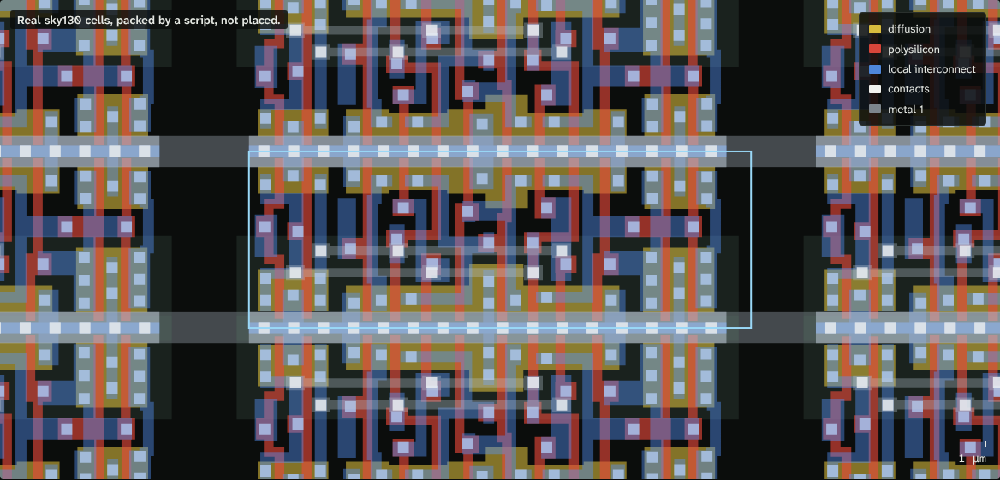 |

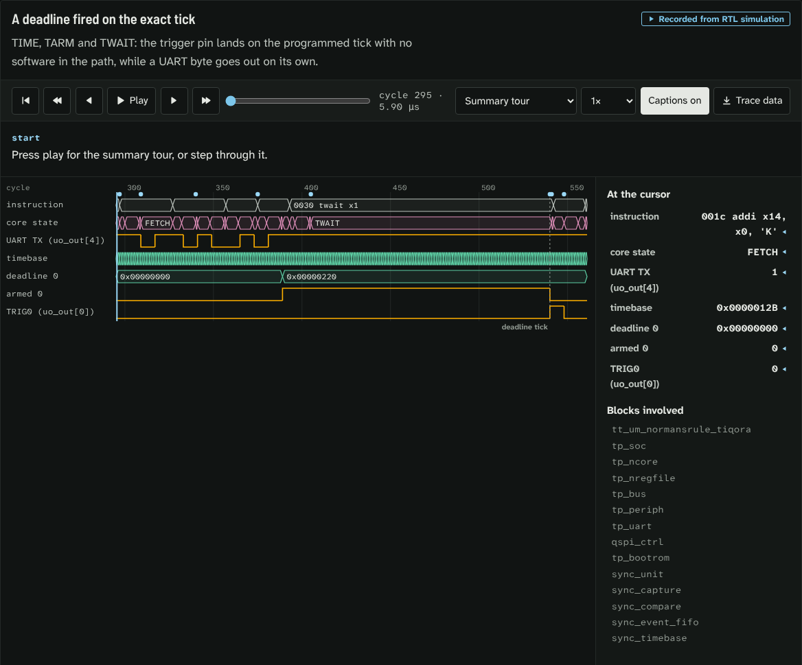

<sub>Photographed from the built pages by `docs/tools/site_shots.py`: the opening shot a little way into its scroll, the rest with reduced motion on.</sub>


| | |
|---|---|
| **Instruction set** | RV32E (all 37 base instructions) + 11 **Xpulse** timing instructions |
| **Core** | nibble-serial: 4 bits per clock, 15 × 32-bit registers |
| **Clock** | 50 MHz target; 20 ns timestamp resolution |
| **Memory** | 16 MB QSPI flash (code) + 2 × 8 MB QSPI RAM (data), via the Tiny Tapeout QSPI Pmod |
| **I/O** | 8 inputs · 8 outputs · UART on the demo board's USB bridge |
| **Timing** | 32-bit timebase with rate trim · 2 deadline triggers · 8 capture channels · event queue |
| **Programming** | through the demo board's own USB-C port, a USB-UART adapter, or the flasher |
| **Speed** | 18.3 clocks per instruction on straight-line code, 40.3 on a mixed sort/checksum/CRC benchmark (measured, RTL simulation, v20): 2.7 and 1.2 million instructions/s at 50 MHz |
| **Logic timing** | 12.45 ns worst path at the slow corner against 20 ns (estimate before wires, `make timing`, main 3684851, 2026-10-27); routed: +7.22 ns typical, −2.30 ns at the worst slow corner (measured, GitHub run 40624722131) |
| **Area** | 50,965 µm² of standard cells, 44% of the 3 × 2 die (measured, `make area`, Yosys 0.33, main 3684851, 2026-10-27, with the cells this design's flow excludes (src/synth_exclude.cells) removed; before placement) |
| **Cost** | 3 × 2 Tiny Tapeout tiles = 420 € (70 € a tile, the price this README has always used) |
| **Verification** | 495 checks in 18 suites and 6 cocotb tests on RTL; the official RISC-V tests 37/37; cocotb on a sky130 gate netlist (measured, main 3684851, 2026-10-27) |

**Contents:** [Status](#status) · [Quick start](#quick-start) · [What it looks like](#what-it-looks-like) · [How small?](#how-small) · [Pinout](#pinout) · [Inside](#inside) · [Memory map](#memory-map) · [Instruction set](#instruction-set) · [Try it today, on the simulated chip](#try-it-today-on-the-simulated-chip) · [Run it on an FPGA today: Digilent Basys 3](#run-it-on-an-fpga-today-digilent-basys-3) · [Using it](#using-it) · [Verification](#verification) · [Design](#design) · [Repository](#repository) · [Maintainer](#maintainer)

## Status

Where the Tiny Tapeout tile stands on the way to silicon. Each rung needs the one before it.

| Stage | State | Evidence |
|---|---|---|
| RTL tested | ✅ done | 495 checks, 6 cocotb tests, official RISC-V tests 37/37, recorded tour 15/15 (`make -C test sim`, `make -C test act`; main 3684851, 2026-10-27) |
| Formally checked | ⬜ not done | no formal proofs exist for this design |
| Synthesized | ✅ done | 50,965 µm², 1,191 flip-flops, 6,099 cells (`make -C test area`); gate-level simulation 5 pass, 1 skipped by design (`make -C test gl`; main 3684851, Yosys 0.33, 2026-10-27) |
| Placed and routed | ✅ done | 3 × 2, placement density 50: the `gds` and `precheck` workflows pass on `main` (GitHub run 40431523830, LibreLane 3.0.14, commit 3684851; the flow reports DRC, LVS and antenna passed); gate-level cocotb on that netlist passes (`gl_test`, same run) |
| Timing checked | ⚠️ misses at the slow corner | setup slack +7.22 ns at the typical corner (nom_tt_025C_1v80), −1.73 ns at nominal slow (nom_ss_100C_1v60) and −2.30 ns at the worst slow corner (max_ss_100C_1v60, 29 paths); hold met at every corner (worst +0.105 ns, fast corner); routing DRC 0, Magic DRC 0, LVS 0, antenna 0, core utilisation 61% (GitHub run 40624722131, 2026-10-28, LibreLane 3.0.14, open_pdks 8afc8346, src/ as on main 3684851). At 20 ns (50 MHz) the chip meets timing on typical silicon and needs about 22.3 ns (≈45 MHz, an estimate from the slack) at the slowest corner. The run also reports max-slew warnings on 2,083 pins and max-capacitance warnings on 13 nets at that corner. On 2026-10-27 the maintainer accepted a slow-corner rating of about 46 MHz, which came from a local run; GitHub's own run puts it at about 45 MHz. The `gds` workflow does not fail on timing |
| Submitted, fabricated, measured | ⬜ not yet | no chip exists |
| FPGA board | ⬜ not yet | the Basys 3 design passes in simulation and its open-flow bitstream passes at the pins in gate-level simulation; nothing has run on a board |

<!-- progress:begin (generated by docs/tools/progress.py from docs/progress.json; do not edit) -->

### Progress

Where Tiqora stands on the way to silicon. Every ✅ and 🔄 below names the version and the command that measured it; re-run the command to check it.

| Milestone | Progress | Step | State | Evidence or next step |
|---|---|---|---|---|
| **FPGA simulation** | `██████████` 3/3 | core and SoC RTL suites | ✅ | 495 checks in 18 suites, plus 6 cocotb tests; measured (main 3684851, 2026-10-27, `make -C test sim`) |
|  |  | official RISC-V tests (RV32E) | ✅ | 37/37; measured (main 3684851, 2026-10-27, `make -C test act`) |
|  |  | whole Basys 3 design in simulation | ✅ | 26 checks across 4 programs; measured (main 3684851, 2026-10-27, `make -C fpga/basys3 sim`) |
| **CPU / GPU / TPU modes** | `██████░░░░` 3/5 | Python model, directed, random and mutant tests | ✅ | 230 checks, seeds 1 to 6; 8 of 8 mutants caught; measured (v20 modes, 2026-10-18, `make -C test modes SEED=1`) |
|  |  | Tiny Tapeout tile unchanged with the modes off | ✅ | gate netlist byte-identical, 6047 cells; measured (v20 modes, 2026-10-18, `bash syn/tile_identity.sh v20`) |
|  |  | CPU, GPU, TPU, CPU program at the Basys 3 pins (simulated) | ✅ | 9 checks; 25 printed lines match sw/modes_model.py; measured (v20 modes, 2026-10-18, `make -C fpga/basys3 sim-modes`) |
|  |  | the same program on a real Basys 3 | ⬜ | next: make bit && make prog in fpga/basys3, then read the USB serial port |
|  |  | full sky130 chip with the modes | ⬜ | next: 71,134 µm² of cells (MODES=1 bash syn/area_sky130.sh, main 3684851, 2026-10-27), 62% of the 3x2 die; never tried in layout |
| **Basys 3 board** | `██████░░░░` 3/5 | bitstream from the open flow | ✅ | Yosys + nextpnr-xilinx + prjxray bitstream; measured (v20, 2026-10-18, `make -C fpga/basys3 bit-open`) |
|  |  | gate netlist of the bitstream at the pins | ✅ | 4/4; measured (v20, 2026-10-18, `make -C fpga/basys3 netlist`) |
|  |  | CPU, GPU, TPU demo on the bitstream's gate netlist | ✅ | 4/4; every serial character matches sw/modes_model.py; measured (v20 modes, Yosys 0.70, 2026-10-18, `make -C fpga/basys3 netlist-modes`) |
|  |  | Vivado bitstream | ⬜ | next: make bit in fpga/basys3 on a machine with Vivado |
|  |  | running on a real board | ⬜ | next: make prog in fpga/basys3, then check the LEDs and the serial port |
| **Tiny Tapeout GDS and pre-flight** | `██████████` 3/3 | cell area after synthesis, before placement | ✅ | 50,965 µm², 1191 flip-flops: 44% of 3x2, with the cells this design's flow excludes (src/synth_exclude.cells) removed; measured (main 3684851, Yosys 0.33, 2026-10-27, `make -C test area`) |
|  |  | place and route at 3x2 | ✅ | GDS at 3x2, placement density 50: the flow reports DRC, LVS and antenna passed; cocotb passes on the routed netlist; measured (main 3684851, LibreLane 3.0.14, `GitHub run 40431523830: gds and gl_test`) |
|  |  | Tiny Tapeout pre-flight | ✅ | pass; measured (main 3684851, `GitHub run 40431523830: precheck`) |
| **sky130 timing** | `███████░░░` 2/3 | logic timing before wires, 50 MHz | ✅ | worst path 12.45 ns at ss_100C_1v60 (6.04 ns typical), budget 20 ns, before wire delay; measured (main 3684851, Yosys 0.33, 2026-10-27, `make -C test timing`) |
|  |  | gate-level simulation on a sky130 netlist | ✅ | 5 pass, 1 skipped by design; measured (main 3684851, 2026-10-27, `make -C test gl`) |
|  |  | signoff timing after routing | 🔄 | setup +7.22 ns typical, -1.73 ns nom_ss, -2.30 ns max_ss (29 paths); hold met (worst +0.105 ns); DRC 0, LVS 0, antenna 0; measured (src/ as on main 3684851, 2026-10-28, LibreLane 3.0.14, open_pdks 8afc8346, `GitHub run 40624722131: gds, signoff timing per corner`) |
| **Silicon** | `░░░░░░░░░░` 0/2 | shuttle submission | ⬜ | next: the owner's step; a clean GDS and pre-flight exist at 3x2, and routed timing misses the slowest corner by 2.30 ns (about 45 MHz there) |
|  |  | first chip tested | ⬜ | next: after the shuttle returns |

✅ done · 🔄 in progress · ⬜ not started · ⛔ blocked. Only measured results count as done.

<!-- progress:end -->

## Quick start

Everything below runs on the simulated chip; you need Icarus Verilog 12 and Python 3
([docs/TESTING.md](docs/TESTING.md) lists the rest).

```sh
make -C test tour                  # the recorded tour: 15 checks, writes test/tour.log
python3 docs/tools/traces.py       # turn that recording into the explorer's tours
make -C test sim                   # every self-check suite
```

Then open `docs/site/index.html` in a browser. The pages are self-contained files with no
network loads, so they work offline and from a clone.

## What it looks like

**Watch it run.** Every recorded tour also plays as an animation: a cursor sweeps the window
from caption to caption and uncovers the waveform the simulation wrote. This one is the whole
tour program, reset to `HALT`; the others sit next to the part of this README they show
(reset and fetch under [Memory map](#memory-map), the add under [Inside](#inside), the deadline
and the capture queue under [Instruction set](#instruction-set) and [Try it](#try-it-today-on-the-simulated-chip)).


<sub>Recorded from `make -C test tour` and drawn by `docs/tools/motion.py`. [Step through it](https://normansrule.github.io/tiqora-skywater130/tours.html#seq=overview). With reduced motion on, it is a still of the whole window.</sub>

**From the board to the silicon.** The chip would arrive in a QFN package on a carrier board that
plugs into the demo board; inside, every project on the shuttle shares one die behind a
multiplexer, and Tiqora is one 3 × 2 block of tiles on it:

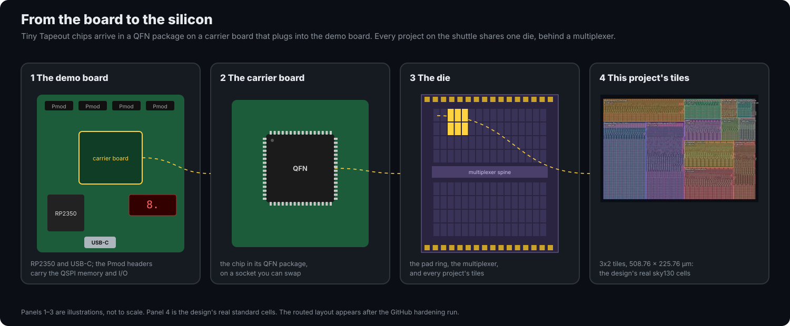

**Where the area goes, to scale.** Each block's measured cell area from synthesis, laid out in
the real 508.76 × 225.76 µm die outline. This is a treemap of measured numbers, not a
placement; the routed layout follows below.


**The real layout, routed.** Every cell where the placer put it and every wire the router drew,
from a local LibreLane 3.0.14 run of `src/config.json` at 3x2 (routed with 0 violations):
`docs/tools/routed_map.py` reads the run's DEF into `docs/site/data/routed.json` and
`docs/tools/routed_render.py` draws it. Only the colours are chosen: each metal layer has its own,
and where layers cross they add.

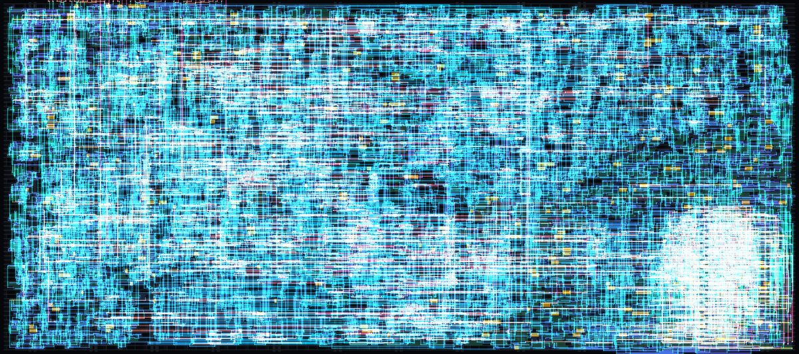

**A clock edge, travelling.** The same layout dimmed, with the clock tree lit in the order an edge
reaches it: from the `clk` pin through 4 levels of clock buffers to all 1,191 flip-flops, which flash.

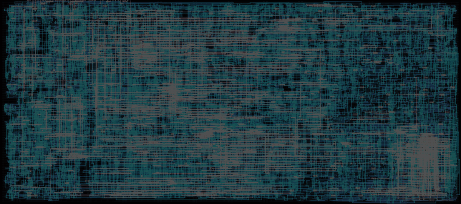

<sub>[Still image](docs/images/routed_clock.png) for readers with motion turned off. [Explore it on the website](https://normansrule.github.io/tiqora-skywater130/physical.html#routed-h): zoom, pan, turn layers on and off, and send the edge yourself.</sub>

**An illustration, not a placement.** Every real sky130 cell of the synthesized design, drawn
with its real geometry but packed into rows block by block by a simple script
(`docs/tools/layout_preview.py`); a placer would put them elsewhere:

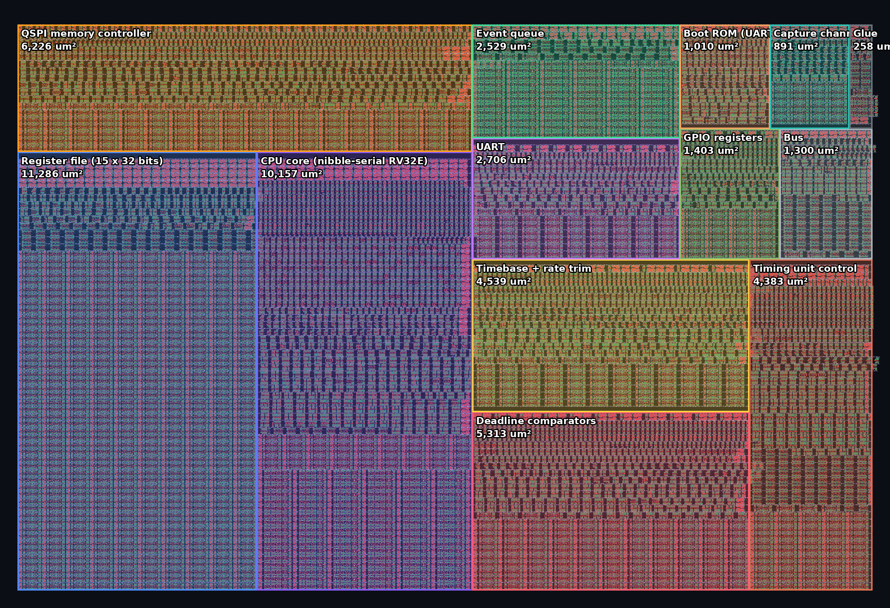

**One flip-flop, taken apart.** The register file is 480 copies of this cell. Its real
manufacturing layers — N-well, diffusion, polysilicon gates, contacts, local interconnect, vias,
metal 1 — separate and rejoin:


The older single-page explorer, [docs/explorer.html](docs/explorer.html), is still here; its
zoom from the tile to transistors is drawn from the same row-packed illustration, not from a
routed layout. The [explorer site](docs/site/index.html) replaces it.

## How small?

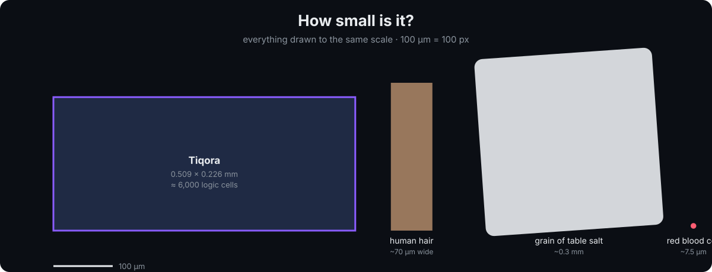

The whole chip — CPU, 480 flip-flops of registers, memory controller, timing unit, UART and
GPIO — is a block of six tiles about 509 µm by 226 µm. A strand of hair is about 70 µm wide; a grain of table salt is
about 300 µm.

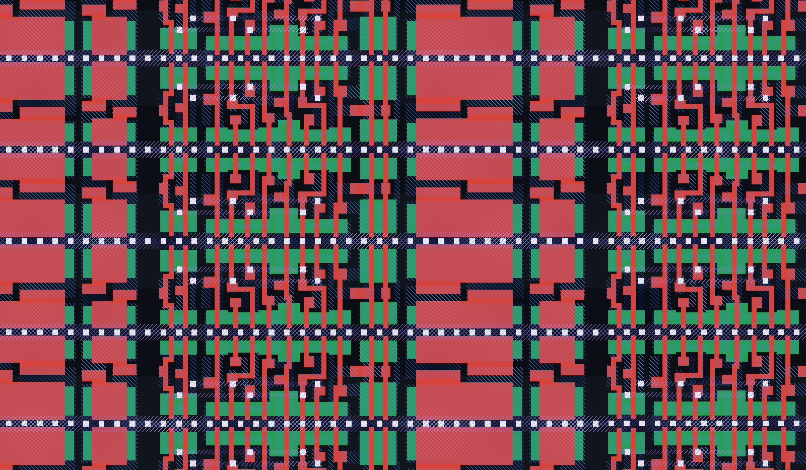

<sub>A 24 × 14 µm window into the register file: real sky130 D flip-flops. Red is
polysilicon (transistor gates), green is diffusion, white squares are contacts, blue
hatching is local interconnect. Every other row is mirrored so neighbours share a power rail.</sub>

## Pinout

**Every pin, where it really is.** All 43 pins of the tile sit on metal 4 along its top edge, at
the exact positions from Tiny Tapeout's own 3 × 2 template, above the design's real cells. The
band names each one with its function; the pulses show which way signals flow:


**What each pin connects to.** The complete system — the QSPI memory Pmod, the demo board's
RP2350 as clock, reset and USB-serial bridge, plus sensors in and triggers out:

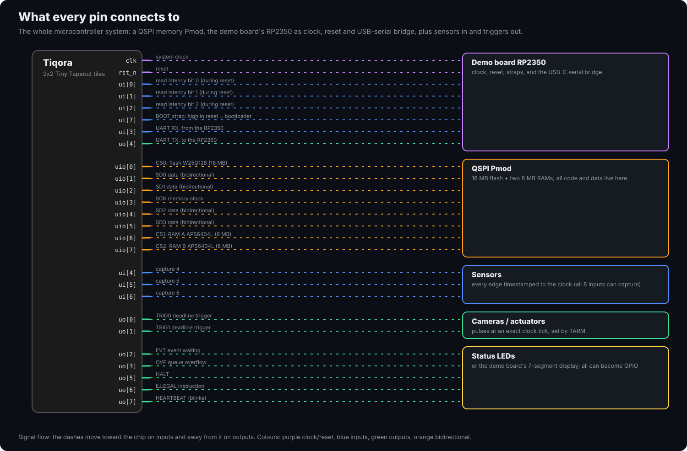

The same pins, by function:

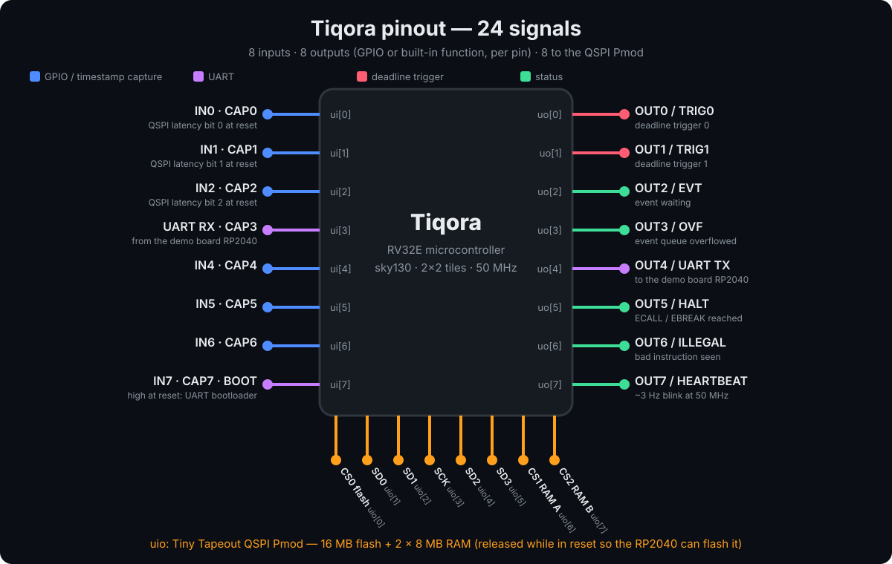

| Pin | Function | Pin | Function (reset) / GPIO |
|---|---|---|---|
| `ui[0]` | IN0 · capture 0 · QSPI latency bit 0 at reset | `uo[0]` | TRIG0 deadline trigger / OUT0 |
| `ui[1]` | IN1 · capture 1 · latency bit 1 | `uo[1]` | TRIG1 deadline trigger / OUT1 |
| `ui[2]` | IN2 · capture 2 · latency bit 2 | `uo[2]` | EVT — an event is waiting / OUT2 |
| `ui[3]` | **UART RX** · capture 3 | `uo[3]` | OVF — event queue overflowed / OUT3 |
| `ui[4]` | IN4 · capture 4 | `uo[4]` | **UART TX** / OUT4 |
| `ui[5]` | IN5 · capture 5 | `uo[5]` | HALT — ECALL/EBREAK reached / OUT5 |
| `ui[6]` | IN6 · capture 6 | `uo[6]` | ILLEGAL instruction seen / OUT6 |
| `ui[7]` | IN7 · capture 7 · **BOOT**: high during reset runs the UART bootloader | `uo[7]` | HEARTBEAT ≈ 3 Hz / OUT7 |

**Every output pin is either a GPIO or its built-in function, chosen per pin by `GPIO_SEL`.**
At reset all eight show their functions, so a freshly powered chip is observable with no
software: the heartbeat blinks, UART TX idles high, HALT lights when a program ends.

`uio[0..7]` connect to the **Tiny Tapeout QSPI Pmod** in its standard pinout (CS0 flash, SD0,
SD1, SCK, SD2, SD3, CS1 RAM A, CS2 RAM B). While reset is held, all eight are released so the
demo board's RP2040 can program the flash without unplugging anything.

**No setup script needed.** The Pmod's flash (W25Q128JV) and RAMs (APS6404L) power up in slow
single-bit mode. Two microseconds after every reset, Tiqora wakes them itself: it puts the
flash into continuous quad read and both RAMs into quad (QPI) mode, and it does this correctly
whether the chips are fresh from power-up or were left in fast mode by a previous run.

## Inside

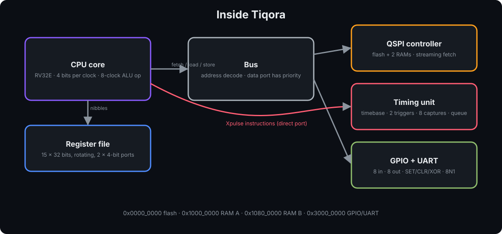

### Why nibble-serial

The biggest block on a small RISC-V chip is the register file, and most of its area isn't
storage — it's the multiplexers that pick one of 16 registers, 32 bits at a time. Tiqora
reads registers **4 bits at a time**, so those multiplexers shrink eightfold. Measured against
the real sky130 library:

| Register file design | Area |
|---|---:|
| Conventional: two 32-bit read ports | 21,837 µm² |
| One 32-bit read port | 18,155 µm² |
| **Tiqora: two 4-bit ports, rotating** | **11,322 µm²** |

Every register rotates by one nibble on every clock, in lockstep with a 3-bit phase counter,
so at phase *k* every register presents its *k*-th nibble on the same four wires:


An addition is eight clocks through one 4-bit adder, the carry held in a flip-flop between them:


The same add, recorded from the RTL: the phase counter, the two nibbles, the carry and the
register-file write, clock by clock.


<sub>Recorded from `make -C test tour` and drawn by `docs/tools/motion.py`. [Step through it](https://normansrule.github.io/tiqora-skywater130/tours.html#seq=nibble-add). With reduced motion on, it is a still of the whole window.</sub>

That sounds slow until you remember that instructions arrive over a 4-bit QSPI bus, at least
16 clocks per word. An 8-clock execute isn't the bottleneck. The same idea lets TinyQV (Michael
Bell) fit a RISC-V microcontroller in 2 × 2 tiles; this is an independent implementation.

### Where the area goes

| Block | Area (µm²) |
|---|---:|
| Register file (15 × 32 bits) | 11,286 |
| CPU core (decode, datapath, control) | 10,157 |
| QSPI memory controller (with power-up wake-up) | 6,226 |
| Deadline comparators (2) | 5,313 |
| Timebase + rate trim | 4,539 |
| Timing unit control | 4,383 |
| UART | 2,706 |
| Event queue | 2,529 |
| GPIO registers | 1,403 |
| Bus | 1,300 |
| Boot ROM (43-instruction UART bootloader) | 1,010 |
| Capture channels (8) | 891 |

<sub>Per-block numbers come from the hierarchical netlist (52,000 µm² total). The flattened netlist
the flow actually builds is smaller, because synthesis optimizes across block boundaries: 50,965 µm²
with Yosys 0.33 (<code>make area</code>) and 48,763 µm² in LibreLane 3.0.14's own synthesis, 44% of the
3 × 2 die. <code>src/config.json</code> sets the placement density to 50. Reproduce with <code>cd test && make area</code>.</sub>

The previous version of this chip had a conventional 32-bit core and measured 69,866 µm² —
it needed 4 × 2 tiles (560 €). The rewrite added the UART and GPIO and fits 3 × 2 (420 €).

## Memory map

| Address | Size | What |
|---|---|---|
| `0x0000_0000` | 16 MB | QSPI flash (CS0) — code and constants, executes in place |
| `0x1000_0000` | 8 MB | QSPI RAM A (CS1) |
| `0x1080_0000` | 8 MB | QSPI RAM B (CS2) |
| `0x2000_0000` | 44 B | timing unit registers, the same ones the Xpulse instructions reach (offsets in `src/tp_pkg.sv`, `SR_*`) |
| `0x3000_0000` | — | GPIO and UART registers |
| `0x4000_0000` | 172 B | boot ROM: the UART bootloader (`sw/mkboot.py`) |

Only address bits 31:28 (which device) and 23:0 (where in it) are decoded (`src/bus/tp_bus.sv`),
so each device repeats every 16 MB inside its 256 MB slot: `0x1100_0000` is RAM A again. The
bootloader takes the length it is sent as given, so `sw/tpload.py` refuses images over 8 MB.

**From reset to the first instruction.** The chip wakes its own flash and RAMs whatever state
they were left in, then reads the first word:


<sub>Recorded from `make -C test tour` and drawn by `docs/tools/motion.py`. [Step through it](https://normansrule.github.io/tiqora-skywater130/tours.html#seq=reset). With reduced motion on, it is a still of the whole window.</sub>

**Two fetches at the pins**, one with a full address preamble and one streamed, at SCK = clk/2:


<sub>Recorded from `make -C test tour` and drawn by `docs/tools/motion.py`. [Step through it](https://normansrule.github.io/tiqora-skywater130/tours.html#seq=fetch). With reduced motion on, it is a still of the whole window.</sub>

**An address with nothing behind it.** A load from `0x5000_0000` waits forever; only reset
recovers:


<sub>Recorded from `make -C test tour` and drawn by `docs/tools/motion.py`. [Step through it](https://normansrule.github.io/tiqora-skywater130/tours.html#seq=stall). With reduced motion on, it is a still of the whole window.</sub>

### GPIO and UART registers (`0x3000_0000` + offset)

| Offset | Name | Access | Meaning |
|---|---|---|---|
| `0x00` | `GPIO_OUT` | RW | value on output pins in GPIO mode |
| `0x04` | `GPIO_IN` | R | the eight input pins, synchronized |
| `0x08` | `GPIO_SEL` | RW | per pin: 1 = built-in function, 0 = GPIO (reset `0xFF`) |
| `0x0C` | `UART_DATA` | W / R | write: send a byte · read: last byte received (clears `RX_VALID`) |
| `0x10` | `UART_STAT` | R | bit 0 `TX_BUSY` · bit 1 `RX_VALID` · bit 2 `RX_OVERRUN` |
| `0x14` | `UART_DIV` | RW | clocks per bit (reset 434 = 115,200 baud at 50 MHz) |
| `0x18` | `GPIO_SET` | W | `GPIO_OUT |= value` |
| `0x1C` | `GPIO_CLR` | W | `GPIO_OUT &= ~value` |
| `0x20` | `GPIO_XOR` | W | `GPIO_OUT ^= value` |

`SET`/`CLR`/`XOR` are the RP2040's trick: changing one pin is a single store, with no
read-modify-write race against other code.

## Instruction set

**RV32E** — the full base integer set with 16 registers (`x0`–`x15`), so a stock
`riscv32-unknown-elf-gcc -march=rv32e -mabi=ilp32e` compiles for it:

| Group | Instructions |
|---|---|
| Arithmetic / logic | `ADD SUB AND OR XOR SLT SLTU` and the `-I` immediate forms, `LUI AUIPC` |
| Shifts | `SLL SRL SRA SLLI SRLI SRAI` |
| Loads / stores | `LB LH LW LBU LHU SB SH SW` |
| Control | `JAL JALR BEQ BNE BLT BGE BLTU BGEU` |
| System | `FENCE` (no-op) · `ECALL`/`EBREAK` halt the core and raise `HALT` |

**Xpulse** — eleven timing instructions on the custom-0 opcode (`0001011`), wrapped as C
functions in `sw/tiqora.h`:

| Instruction | C | What it does |
|---|---|---|
| `TIME rd` | `tp_time()` | read the 32-bit timebase |
| `TPOP rd` | `tp_pop()` | pop the oldest timestamped event (0 if empty) |
| `TSTAT rd` | `tp_stat()` | queue count, flags, armed channels, live pin levels |
| `TWAIT rs1` | `tp_wait(t)` | park the core until time `t` (wrap-safe) |
| `TARM rs1, rs2` | `tp_arm(t, ch)` | fire trigger `ch` exactly at tick `t` |
| `TPULSE rs1` | `tp_pulse(mask)` | fire the triggers in `mask` now |
| `TMARK rd, rs1` | `tp_mark(tag)` | queue a software event; returns its timestamp |
| `TADJ rs1` | `tp_adj(d)` | step the timebase by a signed amount |
| `TRATE rs1` | `tp_rate(r)` | trim the timebase rate (clock discipline) |
| `TCFG rs1` | `tp_cfg(c)` | enable capture channels and pick edges |
| `TPW rs1` | `tp_pw(n)` | set trigger pulse width in clocks |

Not implemented, by design: interrupts, CSRs, compressed instructions, misaligned-access
traps. An illegal instruction is skipped and latches the `ILLEGAL` pin.

Both of those, recorded: an illegal word raises `ILLEGAL`, then three pin edges arrive at a
two-deep queue, two are popped in order with exact timestamps and the third raises `OVF`:


<sub>Recorded from `make -C test tour` and drawn by `docs/tools/motion.py`. [Step through it](https://normansrule.github.io/tiqora-skywater130/tours.html#seq=capture). With reduced motion on, it is a still of the whole window.</sub>

**CPU, GPU and TPU modes** (FPGA and full-chip builds only, not the Tiny Tapeout tile).
`MSET` switches the core between CPU mode, a GPU mode with eight byte-lane pixel
instructions on custom-2, and a TPU mode with an int8 dot-product accumulator on custom-3.
An instruction used outside its mode traps like any illegal instruction. Encodings, cost
and evidence: [docs/MODES.md](docs/MODES.md). From C: `sw/tiqora_modes.h`.

## Try it today, on the simulated chip

No board and no silicon needed. The simulator runs the real RTL — the same design that gets
fabricated — booting from a model of the QSPI flash exactly as the chip will:

```bash
cd tiqora-skywater130/test
python -m pip install ziglang pyelftools          # a C compiler, no cross-toolchain needed
make run PROG=../sw/examples/hello.c
```

```
--- Tiqora (simulated RTL, 50 MHz) ---
Hello from Tiqora!
tick 1: deadline t0+100000, woke 16 clocks after
tick 2: deadline t0+200000, woke 16 clocks after
tick 3: deadline t0+300000, woke 16 clocks after
...
```

Two different things are deterministic here, and they are worth keeping apart:

- **The trigger pin is exact.** A deadline armed with `tp_arm` drives its pin on the programmed
  tick, whatever the CPU is doing (checked at the pin by `make soc`). Exact relative to the
  supplied clock; oscillator error and pad delay are separate.
- **Software resumes within a fixed window.** After `tp_wait`, the next instruction runs 10 to 17
  clocks after the deadline. The spread is not noise: every instruction starts on phase 0 of the
  register file's 8-clock rotation, so the delay depends on which phase the deadline falls on.
  For deadlines on the same phase, as in this demo, it repeats exactly. `make latency` measures
  all eight phases and checks the bound.


And recorded, not drawn: `TIME`, `TARM` and `TWAIT`, then `TRIG0` rising on the armed tick
while a UART byte goes out on its own.


<sub>Recorded from `make -C test tour` and drawn by `docs/tools/motion.py`. [Step through it](https://normansrule.github.io/tiqora-skywater130/tours.html#seq=deadline). With reduced motion on, it is a still of the whole window.</sub>

Point `PROG=` at any C file of your own.

**Speed, measured** (RTL simulation at 50 MHz, `make run PROG=... RUNARGS=+PROFILE`):

| Program | v19 | v20 | |
|---|---:|---:|---|
| Straight-line ALU code (`bench_alu.c`) | 32.2 clocks/instr | **18.3** | 1.76× |
| Sort + checksum + CRC-32 (`bench_kernel.c`) | 50.2 | **40.3** | 1.24× |
| The C self-test, from flash | 406,049 clocks | **337,417** | 1.20× |

v20 starts fetching the next instruction while the current one executes, for every instruction
that cannot change the flow or use the bus (63% of a typical stream). The word is held in the
QSPI controller's own receive register until the core is ready, so the speedup costs one
flip-flop, one 30-bit address mux and about 1.7% more logic. Two thirds of the remaining time is
still the QSPI bus: loads, stores and taken branches each restart a memory transaction.

Printing a line with three numbers costs about 30,000 clocks, so `tp_io.h`'s `uart_putu` avoids
division entirely — the core has no hardware divider, and the usual `v % 10, v / 10` loop would
cost tens of thousands of clocks per number.

## Run it on an FPGA today: Digilent Basys 3

The same RTL runs on a [Digilent Basys 3](fpga/basys3/README.md) (Artix-7) with nothing else
attached. The QSPI flash and RAMs are emulated in block RAM, following the same datasheet rules as
the real chips, and the board's own USB port is Tiqora's serial port, so you load C programs
with the bootloader exactly as on the chip:

```bash
cd fpga/basys3
make sim          # simulate the whole board first: three runs, all checked
make bit && make prog                 # Vivado: build and load
```

Then a terminal at 115,200 baud shows the demo: buttons timestamped to the 20 ns tick, LED 0
blinking from the timebase, and an echo. With the real QSPI Pmod on port JA, `make bit PMOD=1`
tests the actual memory chips. Full guide: [fpga/basys3/README.md](fpga/basys3/README.md).

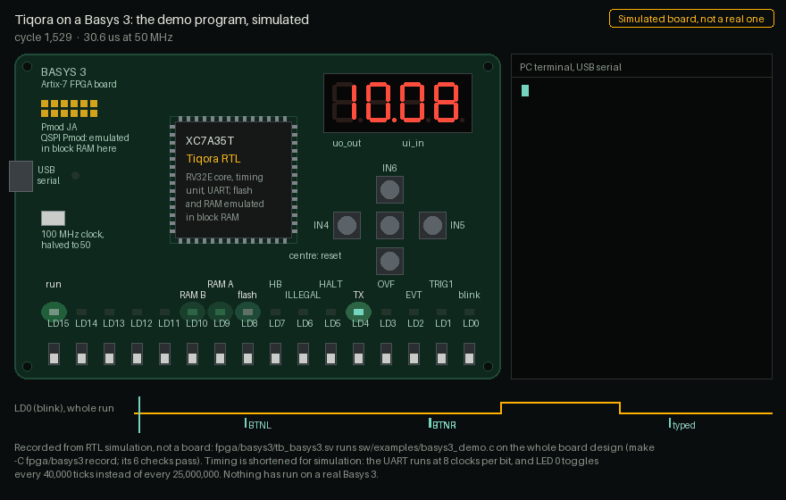

<sub>**Simulated, not a real board.** `make -C fpga/basys3 record` runs the demo on the whole board
design in Icarus Verilog, with the UART and the blink sped up so it fits in a short run;
`fpga/basys3/rec_basys3.sv` writes down the LEDs, the 7-segment display, the buttons and the
serial port, and `docs/tools/fpga_media.py` draws them. Nothing has run on a real Basys 3 yet.
[Still image](docs/images/explorer/fpga.png) for readers with motion turned off.</sub>

## Using it

**Hardware:** a Tiny Tapeout demo board and the Tiny Tapeout QSPI Pmod on the bidirectional
Pmod header.

1. **Flash your program** into the Pmod with the
   [Tiny Tapeout Flasher](https://github.com/TinyTapeout/tinytapeout-flasher) while the design
   is held in reset — the chip releases the Pmod pins for exactly this.
2. **Select** `tt_um_normansrule_tiqora` on the demo board. `ui_in[2:0]` set the QSPI read
   latency while reset is held (0 works for the Pmod at 50 MHz in simulation; raise it if
   reads come back shifted).
3. **Release reset.** The heartbeat on `uo_out[7]` starts blinking, and the program runs from
   flash address 0.
4. **Talk to it:** `uo_out[4]`/`ui_in[3]` are wired to the RP2040's UART, 115,200 baud by default.

A minimal program (see `sw/mkhello.py` for the exact instruction stream the tests run):

```c
#include "tiqora.h"
#define PERIPH ((volatile uint32_t *)0x30000000)
#ifndef ONE_SECOND
#define ONE_SECOND 50000000u                // timebase ticks per second at 50 MHz
#endif
void uart_putc(char c) { while (PERIPH[4] & 1); PERIPH[3] = c; }   // UART_STAT, UART_DATA
int main(void) {
    // GPIO_SEL: 1 = the pin keeps its built-in function, 0 = it becomes GPIO.
    // Keep UART TX (uo_out[4]) and TRIG0 (uo_out[0]); uo_out[7] becomes a GPIO.
    PERIPH[2] = (1u << 4) | (1u << 0);
    for (const char *s = "Hi Tiqora\n"; *s; s++) uart_putc(*s);
    uint32_t t = tp_time() + ONE_SECOND;    // one second from now
    tp_arm(t, 0);                           // TRIG0 fires on that exact tick
    tp_wait(t);
    PERIPH[8] = 0x80;                       // GPIO_XOR: toggle uo_out[7], now a GPIO
    return 0;
}
```

### Write C for it

Any RV32E C compiler works. If you don't have a RISC-V toolchain installed, the Clang inside
the `ziglang` pip package does the job, and it's what this repository's own tests use:

```bash
pip install ziglang pyelftools pyserial
cd sw
make TOOLCHAIN=zig            # camera_sync.bin, for flash
make TOOLCHAIN=zig RAM=1      # the same program linked for RAM, for the bootloader
```

(With a GNU toolchain, drop `TOOLCHAIN=zig`.) Include `tiqora.h` for the timing
instructions and `tp_io.h` for the UART and GPIO (`uart_puts`, `uart_putu`, `GPIO_OUT`, ...).
`sw/lib/rt.c` supplies the multiply and divide routines the compiler calls, since the core
has no hardware multiplier.

Two more libraries cover what you reach for first on any microcontroller:

- **`tp_printf.h`**: `tp_printf("t=%u id=%08x\n", t, id)` — `%d %i %u %x %X %c %s %%` with
  widths and zero padding, checked character for character against Python's `%` formatting.
  It prints numbers without dividing, so it stays fast on a core with no divider.
- **`tp_spi.h`**: an SPI master in software on the GPIO pins (mode 0, about 100 kHz at 50 MHz),
  for sensors, flash chips and small displays. Tiqora spends its silicon on the core and the
  timing unit instead of SPI hardware; the RP2040-style `GPIO_SET`/`GPIO_CLR` registers make
  a software SPI short and race-free. Tested against a simulated W25Q128 flash, whose JEDEC ID
  it reads correctly (`sw/examples/spi_flash_id.c`).

Every build is checked by `sw/rv32e_check.py`, which decodes each instruction and refuses
anything Tiqora doesn't implement — a multiply, a CSR access, a compressed instruction, a
register above x15 — so a wrong compiler flag fails at build time, not on the board.

`sw/examples/c_selftest.c` is the proof it all works: initialized and zeroed globals, strings in
flash, recursion on the stack, software multiply and divide, function pointers and a timed
`tp_wait`. The testbench runs it from flash and again over the UART bootloader, and checks every
character it prints.

### Program it through the demo board's USB-C port

No adapter needed: `sw/demoboard/tpboot.py` runs on the demo board and becomes the serial cable.
It clocks Tiqora at 4.17 MHz so the chip's UART lands at 9600 baud without changing
anything on the chip, holds the boot pin, sends your program and shows what it prints:

```bash
pip install mpremote
mpremote cp sw/demoboard/tpboot.py :tpboot.py && mpremote cp app.bin :app.bin
mpremote exec "import tpboot; tpboot.load('app.bin')"
```

Its protocol and bit timing are tested on a PC against a simulated chip with timing jitter, clock
error and counter wrap-around. **[docs/BRINGUP.md](docs/BRINGUP.md)** walks through a real board
from first power-up, including what each status pin means when something's wrong.

### Program it over USB serial — no flasher

Tiqora has a boot ROM, the way an RP2040 does. **Hold `ui_in[7]` high while you release
reset** and, instead of running flash, the chip runs a 43-instruction bootloader that takes a
program over the UART:

```
chip → PC   TP>                               ready
PC → chip   length (4 bytes, little endian), then the program
chip → PC   checksum byte, then K              verified
            the program runs from RAM at 0x1000_0000
```

On the PC side, `sw/tpload.py` does all of it (it only needs `pyserial`):

```bash
cd sw && make TOOLCHAIN=zig RAM=1                  # camera_sync.bin, linked for RAM
python3 tpload.py -p /dev/ttyUSB0 camera_sync.bin --monitor
```

Any 3.3 V USB-to-UART bridge works: its TX to `ui_in[3]`, its RX to `uo_out[4]`, and ground.
A program loaded this way runs from RAM and is gone at power-off; to keep one permanently,
put it in flash with the Tiny Tapeout flasher. Code can also jump to `0x4000_0000` at any time to
re-enter the bootloader, like `reset_usb_boot()` on an RP2040.

### Honest comparison with an RP2040

| | Tiqora | RP2040 |
|---|---|---|
| Cores | 1 × RV32E, nibble-serial | 2 × Cortex-M0+ |
| Speed | 1.2–2.7 million instructions/s at 50 MHz (measured) | ~133 MHz, ~1 instruction/clock |
| Memory | 16 MB flash + 16 MB RAM (external, QSPI) | 264 KB SRAM + external flash |
| I/O | 8 in, 8 out, UART | 30 GPIO, USB, ADC, SPI, I2C, PWM, PIO |
| Hardware timestamping | 20 ns, 8 channels, queued | — (software or PIO) |
| Cycle-exact deadline outputs | yes, 2 | via PIO |
| You designed the silicon | **yes** | no |

Tiqora is not a replacement for an RP2040. It is a working RISC-V microcontroller you can
read every line of, down to the transistors, with a timing unit most microcontrollers don't have.

## Verification

**Every command to test everything is in [docs/TESTING.md](docs/TESTING.md).**

| Test | What it proves | Checks |
|---|---|---:|
| `make isa` | every RV32E base instruction, vs. Python-computed results | 51 |
| `make unit` | timing unit blocks, rotating register file, UART, GPIO | 50 |
| `make stress` | 8 simultaneous captures, queue overflow, 2³² rollover | 18 |
| `make xpulse` | all eleven Xpulse instructions | 15 |
| `make soc` | boots, arms a deadline, trigger lands on the exact tick | 12 |
| `make wrap` | `TWAIT` held correctly across the timebase rollover | 10 |
| `make boot` | UART bootloader: a program sent over serial lands in RAM and runs, and a warm entry with hostile registers | 14 |
| `make wake` | the chip wakes the flash and RAM itself, from cold, warm and pre-set states | 14 |
| `make c` | Clang-compiled C, run from flash and over the UART bootloader, output checked | 12 |
| `make mcu` | the chip as a microcontroller: C from flash talks to a host over the UART both ways, reads and drives pins, fires a trigger on an exact tick, timestamps an input edge, uses RAM | 16 |
| `make act` | **the official RISC-V architecture tests** (riscv-arch-test, RV32E): signatures vs the golden model, run from RAM | **37 / 37** (main 3684851, 2026-10-27) |
| `make bridge` | the demo-board bridge vs a simulated chip: jitter, ±2% clock error, counter wrap | 10 |
| `make -C ../fpga/basys3 sim` | the whole Basys 3 design at 100 MHz: C from emulated flash, the bootloader over USB serial, the button demo | 26 |
| `make printf` | `tp_printf` against Python's `%` formatting, 23 cases | 23 |
| `make spi` | software SPI reads a simulated W25Q128's JEDEC ID | 2 |
| `make readme` | this README's minimal program, compiled verbatim, from flash and RAM: one 8-tick pulse at the TRIG0 pin, the greeting, the GPIO toggle | 10 |
| `make latency` | software resumes 10–17 clocks after a `TWAIT` deadline, for deadlines on all 8 rotation phases | 1 |
| `make adjust` | a time step neither skips nor repeats a deadline (fires at the step; a broken equality comparator fails it) | 3 |
| `make shared` | the timing unit and its reference model are byte-identical to Tiqora-Serial's (SHA-256 manifest in both repositories) | 7 files |
| `make modes` | the CPU / GPU / TPU modes build (`TIQORA_MODES`, not in the tile): every GPU and TPU instruction against `sw/modes_model.py`, wrong-mode traps, switch latency ([docs/MODES.md](docs/MODES.md)) | 230 |
| `make syncref` | the timing unit against a Python reference model, every output on every clock, 60,000 random clocks in each of three builds, and no pin event lost without overflow (two bugs it found are fixed, [docs/TESTING.md](docs/TESTING.md)) | 4 |
| Tiny Tapeout pre-flight | CI's own project checker (TinyTapeout/tt-gds-action/precheck) on the routed 3x2 layout | passes (main 3684851, GitHub run 40431523830) |
| `make timing` | critical-path estimate from real sky130 cell delays | 12.45 ns / 20 ns at the slow corner, 6.04 ns typical, estimate before wires (main 3684851, 2026-10-27) |
| `make` (cocotb) | from the pins only: firmware printing over the UART, the boot strap | 6 |
| `make gl` | the same cocotb tests on a netlist synthesized to sky130 cells (`make GATES=yes` on the post-layout one) | 5 + 1 skipped (main 3684851, 2026-10-27) |
| `tpload.py selftest` | the PC-side loader: framing, checksum, error cases | 7 |
| `make lint` | Verilator `-Wall`, no waivers | clean |

Tiqora was cross-checked against the RISC-V conformance suite and against TinyQV, the
closest silicon-proven design; [docs/REFERENCES.md](docs/REFERENCES.md) lists what matched and
what changed. One item stands out: TinyQV avoids the RAM's 8 µs refresh rule by never running
code from RAM, while Tiqora deliberately does (for the bootloader), so the RAM model now
enforces the datasheet's chip-select timing and every test that runs code from RAM checks it.

The memory models are strict: like the real chips, they ignore fast transactions until they
have been woken up properly. An earlier version of the models was forgiving, and hid the fact
that the chip never woke its memories — it simulated perfectly and would not have run a single
instruction on a real board. Making the models strict exposed that, and the wake-up sequence
fixed it.

Compiling real C for the first time found two more bugs that no hand-assembled test could:
the flash linker script put initialized globals in RAM with no copy stored in flash, and the
start-up code never copied them. Any program with `int x = 5;` at file scope would have been
broken on the board. Both are fixed, and putting the bug back makes `make c` fail loudly: the
program prints `data 1` instead of `data 42`, then calls a function pointer that was never
initialized and restarts itself forever.

The tests were checked against themselves: six deliberate bugs were injected (a register-file
nibble mis-write, UART sampling at the bit edge, `GPIO_CLR` acting as toggle, signed compares
treated as unsigned, arithmetic shifts losing the sign, a dropped carry between nibbles), and
the suite caught every one. One test was too weak to catch the `GPIO_CLR` bug at first; it was
strengthened.

## Design

The explorer site is meant to read like a logic analyser's capture, kept calm enough for long
reading. We call the direction **Scope**.

- **Time runs left to right.** A thin cycle ruler under the header marks each section as a tick
  and follows your place on the page. Recorded traces are amber; the cursor that marks "now",
  links and focus rings are one cool probe blue. Light mode is the capture printed on paper;
  dark mode is the instrument's screen.
- **Readable first.** Body text is Atkinson Hyperlegible Next and values are Atkinson
  Hyperlegible Mono, both drawn so that 0/O and 1/l/I never get confused on pages full of
  `0x0000012B`. Headings use Barlow Semi Condensed, the lettering of an instrument's front
  panel. Lines stay around 56 characters. All three fonts are SIL Open Font License files
  inlined into the pages.
- **Colour never carries meaning alone.** Every evidence label has a word and a drawn shape,
  every signal row and block has its name, and the block colours were checked for
  colour-vision deficiency in both themes.
- **Motion is physical and quiet.** The tour cursor, the deadline lab and the register ring move
  on a critically damped spring: they arrive quickly and settle without bouncing, and you can
  interrupt them. Buttons give a 0.97 press. With reduced motion turned on, everything jumps
  straight to its end state.
- **The zoom is drawn the way [Visual 6502](http://www.visual6502.org/) draws a die**: every
  layer as translucent colour on black, so a transistor shows where red polysilicon crosses
  yellow diffusion. The cells and their geometry are Tiqora's real sky130 cells
  (`docs/tools/die_map.py`); their positions come from a row packer, not a placer, and the page
  says so at every zoom level. No Visual 6502 code or data is used, only the idea of the view.
  As you scroll the stage stays still and the camera follows on a spring; with reduced motion it
  becomes four still views with buttons.
- **The overview opens like a product page.** The name, then the tile of real cells lying tilted
  in perspective; as you scroll the copy lifts away and the tile settles flat, straight into the
  zoom. Then four big numbers, each with how it was obtained. Scroll sets the target and the
  same spring follows it; with reduced motion the tile simply rests flat.
- **The Basys 3 board is a recording too, and it plays live.** On the overview you can play or
  drag through the recorded run (`docs/site/lib/board.js`); the README shows the same run as an
  animation. It looks like the board (green board, red 7-segment digits, green LEDs at their real
  duty cycle) but every frame comes from a simulation, and its corner says *Simulated board, not
  a real one*.
- **Honest about where numbers come from.** Labs say *computed* and link to the recording they
  are derived from; the zoom says *illustrative* where it is; nothing is drawn by hand.

Every page works without JavaScript as plain text, keeps its keyboard controls, and has no
horizontal scroll at phone width.

## Repository

```
src/core/      tp_ncore.sv (the CPU), tp_nregfile.sv (rotating register file)
src/sync/      timebase, capture, event queue, deadline comparators, Xpulse port
src/periph/    tp_uart.sv, tp_periph.sv (GPIO + UART registers)
src/boot/      tp_bootrom.sv, generated by sw/mkboot.py
src/bus/       address decode, QSPI controller
src/tp_soc.sv  the microcontroller;  tt_um_normansrule_tiqora.sv  pin wrapper
src/config.json  hardening configuration
sw/demoboard/  tpboot.py: program Tiqora through the demo board's USB-C port
sw/            tiqora.h (timing), tp_io.h (UART/GPIO), tp_printf.h, tp_spi.h, crt0.S, link.ld, link_ram.ld,
               lib/rt.c, rv32e_check.py, tpload.py (UART loader), examples/, program generators
test/          every testbench above
fpga/basys3/   the Digilent Basys 3 build; rec_basys3.sv records a simulated run (make record)
docs/site/     the explorer site: pages/ (templates), lib/ (shared styles, scripts and fonts),
               data/ (atlas, tours, die map), and the built pages next to them
docs/atlas/    hand-written notes the atlas adds to what it reads from the RTL
docs/fpga/     the recorded Basys 3 run behind the board animation
docs/tools/    atlas.py, traces.py, die_map.py, build_site.py, check_site.py, readme_media.py,
               motion.py, site_shots.py, fpga_media.py: the site and its README pictures;
               layout_preview.py, figures.py, build_explorer.py: the other images
syn/           synthesis and area scripts
.github/       Tiny Tapeout CI: gds (hardening, pre-flight, gate-level test), test, docs, fpga;
               pages (publishes docs/site to GitHub Pages)
```

Sister project: [tinytapeout-tiqora](https://github.com/Normansrule/tinytapeout-tiqora)
— the same timing unit with no CPU, controlled over USB serial, in 1 × 2 tiles (140 €).

## Maintainer

Maintained by [@Normansrule](https://github.com/Normansrule); see [MAINTAINERS.md](MAINTAINERS.md).

Apache 2.0 licensed. Credits: the nibble-serial approach follows TinyQV by Michael Bell;
the sky130 PDK is by SkyWater and Google; fabrication via Tiny Tapeout.
